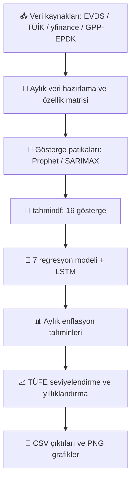

<div align="center">

# 🇹🇷 Türkiye Enflasyon Tahmin Modeli

### 📈 Turkey Inflation Forecasting — Hybrid Machine Learning & Time Series

**16 ekonomik gösterge · 7 regresyon modeli + LSTM · Prophet / SARIMAX · Senaryo tabanlı tahmin**


*Türkiye'nin aylık ve yıllık TÜFE enflasyonunu, makroekonomik gösterge tahminleriyle beslenen hibrit bir model üzerinden öngörmeye yönelik Python projesi.*

**[🎯 Son sonuçlar](#sonuc) · [🧠 Mimari](#mimari) · [🗂️ Veri](#veri) · [🚀 Çalıştırma](#calistirma) · [🛠️ Senaryolar](#senaryo)**

</div>

---

## 🌍 English overview

A hybrid forecasting project for **Türkiye's Consumer Price Index (CPI) inflation**. It forecasts the paths of **16 economic indicators** using Prophet and SARIMAX/auto-ARIMA approaches, combines those forecasts into a feature matrix, and feeds **seven regression models and an LSTM** to generate monthly inflation projections and derived annual inflation estimates.

The original **2023 model architecture** is preserved; data inputs and broken integration points have been updated. The figures below describe a specific historical run, **not live predictions**.

## ✨ Proje ne yapıyor?

- 📊 **16 makroekonomik göstergeyi** veri kaynaklarından toplar ve hazırlar.
- 🔮 Göstergelerin gelecek dönem patikalarını **Prophet** ve **SARIMAX / auto_arima** ile tahmin eder.
- 🧩 Bu patikaları **`tahmindf`** adlı ortak özellik matrisinde birleştirir.
- 🧠 **7 regresyon + LSTM** ile aylık enflasyon tahminleri üretir.
- 📈 Aylık tahminleri TÜFE seviyelerine ve **12 aylık yıllık enflasyon** değerlerine dönüştürür.
- 🎛️ Faiz ve ücret artışı varsayımlarını **tarih etiketli senaryolarla** değiştirilebilir tutar.
- 📉 Ortalama, medyan, minimum ve maksimum model sonuçlarını raporlar; grafikleri PNG olarak kaydeder.

> [!NOTE]
> Bu çalışma, 2023'te geliştirilen modelin **değişken seçimi, hiperparametreleri ve temel işlem sırasını korur**. Değiştirilen alanlar veri kaynakları, zaman hizalamaları, senaryo atamaları ve çalıştırma altyapısıdır.

<a id="mimari"></a>

## 🧠 Model mimarisi



**Regresyon modelleri:** SGD, Linear Regression, Lasso, Lars, Kernel Ridge, Gaussian Process ve Bayesian Ridge. **LSTM** sonuçları 10 farklı tohum üzerinden ortalanır.

**Bileşen patikaları:** Göstergeye göre Prophet'in linear/logistic yöntemleri veya `auto_arima` (SARIMAX) kullanılır. Motorin için USD ve Brent hareketlerini birleştiren ayrı bir hesaplama bulunur.

<a id="veri"></a>

## 🗂️ Veri kaynakları

| Gösterge / veri grubu | Kaynak | Açıklama |
|---|---|---|
| TÜFE endeksi | **TCMB EVDS** | Eski ve yeni seriler `zincirle()` ile bağlanır |
| USD/TL | **TCMB EVDS** | Günlük veriden aylık ortalama; parçalı veri indirme |
| Para arzı ve M3 | **TCMB EVDS** | Seri geçişlerinde zincirleme |
| Kredi hacmi | **TCMB EVDS** | Seri geçişlerinde zincirleme |
| Politika, kredi ve mevduat faizi | **TCMB EVDS** | Makroekonomik ve senaryo girdileri |
| İşsizlik | **TCMB EVDS** | İşsizlik serisi |
| Kamu borcu | **TCMB EVDS** | Kamu borç verisi |
| Reel efektif döviz kurları | **TCMB EVDS** | ÜFE ve TÜFE bazlı endeksler |
| Enflasyon belirsizliği ve BEK beklentileri | **TCMB EVDS** | Belirsizlik göstergesi ve karşılaştırma verileri |
| Brent petrolü | **yfinance** | `BZ=F` fiyatlarından aylık seri |
| Perakende satış ve sanayi üretimi | **TÜİK** | Yerel `.xls` dosyaları |
| Motorin fiyatı (TL/L) | **GPP / EPDK** | Yerel `.xlsx`, arşiv kaynaklarından güncellenir |

<details>
<summary>🔎 EVDS seri kodlarını göster</summary>

| Veri | Seri kodu |
|---|---|
| TÜFE | `TP.FE.OKTG01`, `TP.TUKFIY2025.GENEL` |
| USD/TL | `TP.DK.USD.S.YTL` |
| Para arzı | `TP.PR.ARZ13`, `TP.PBD.H09` |
| M3 | `TP.PR.ARZ22`, `TP.PBD.H17` |
| Kredi hacmi | `TP.KREDI.L001`, `TP.KREHACBS.A1` |
| İşsizlik | `TP.TIG08` |
| Politika faizi | `TP.APIFON4` |
| Kredi faizi | `TP.KTFTUK` |
| Mevduat faizi | `TP.TRY.MT02` |
| Kamu borcu | `TP.KB.A09` |
| Reel efektif kur | `TP.RK.U01.Y`, `TP.RK.T1.Y` |
| Enflasyon belirsizliği | `TP.BEK.S01.E.S` |
| BEK beklentileri | `S01.A.U`, `S01.B.U`, `S01.C.U`, `S01.E.U` |

</details>

> **Veri ilkesi:** Eksik gözlemler uydurulmaz. Eski/yeni EVDS serileri, çakışan dönemlerdeki ortalama oranlara göre zincirlenir.

<a id="sonuc"></a>

## 🎯 Son tahmin sonuçları

**18 Kasım 2026 tarihli kayıtlı çalıştırma** (`tam_calisma10.log`):

| Ölçüt | Kayıtlı sonuç |
|---|---:|
| Model girdisi | Haziran 2013 – Eylül 2026 (160 ay) |
| Son gerçek TÜFE seviyesi | Ekim 2026 |
| Tahmin dönemi | Kasım 2026 – Kasım 2027 (13 ay) |
| 2026 sonu yıllık enflasyon | Yaklaşık **%30** |
| 2027 sonuna yakın yıllık enflasyon tahmini (model ortalaması) | Yaklaşık **%24,1** |
| Model sonuçları aralığı | **%21,2 – %25,6** |
| Kasım 2026 TCMB BEK, 12 ay sonrası beklenti | **%24,0** |

**📌 Yorum:** Modelin yaklaşık **%24,1** tahmini, aynı dönemdeki **%24,0** TCMB BEK beklentisine yakındır. Bu karşılaştırma, bağımsız bir *out-of-sample* başarı testi veya istatistiksel çapraz doğrulama **değildir**. Çalıştırmanın son tahmin ayı **Kasım 2027** olduğu için “2027 yıl sonu” ifadesi yaklaşık bir dönem tanımıdır.

> [!IMPORTANT]
> Bu sayılar **18.11.2026 tarihli belirli bir koşuya** aittir. Senaryo varsayımları ve yeni veri girişleri sonuçları değiştirebilir. Aralık, model sonuçlarının minimum–maksimum değeridir; kendiliğinden bir istatistiksel güven aralığı anlamına gelmez.

## 🗃️ Projedeki dosyalar

| Dosya / klasör | Görevi |
|---|---|
| `enflasyon.py` | 🔒 2023 tarihli özgün referans; **değiştirilmez** |
| `enflasyon_guncel.py` | ▶️ Güncel veriyle çalıştırılan ana betik |
| `motorin_tarihleri_tamamlanmis.xlsx` | ⛽ Motorin tarihsel fiyat serisi |
| `motorin_tarihleri_tamamlanmis_YEDEK.xlsx` | 🗄️ Önceki motorin verisi yedeği |
| `ticaret satis hacim endeksi 2021=100.xls` | 🛍️ TÜİK perakende satış verisi |
| `sanayi uretim endeksi 2021=100.xls` | 🏭 TÜİK sanayi üretimi verisi |
| `data.csv`, `df.csv`, `df6.csv` | 🧮 Ara veri çıktıları |
| `yıllıktahmin.csv` | 🎯 Yıllık enflasyon tahminleri; ana çıktı |
| `modelaylık.csv`, `aylık.csv` | 📅 Aylık model ve karşılaştırma çıktıları |
| `grafikler/` | 🖼️ Oluşturulan grafikler (PNG) |

> Bazı CSV ve grafik dosyaları **çalıştırma sırasında üretilir**; depoda önceden bulunmaları zorunlu değildir. TÜİK ve motorin veri dosyaları ise betiğin yerel girdi kaynaklarıdır.

<a id="calistirma"></a>

## 🚀 Çalıştırma

**Ön koşullar:** Python ortamı, betiğin kullandığı kütüphaneler, gerekli yerel TÜİK/motorin dosyaları ve geçerli bir **TCMB EVDS API anahtarı**.

> [!CAUTION]
> **GitHub'a API anahtarı koymayın.** Proje notlarında anahtarın betik içinde tanımlandığı belirtiliyor. Depoyu herkese açmadan önce anahtarı koddan çıkarın, gerekiyorsa yenileyin ve kodun ortam değişkeninden okumasını sağlayın. Aşağıdaki çalıştırma adımı, bu güvenlik düzenlemesi ve bağımlılık kurulumu yapıldıktan sonra kullanılmalıdır.

**Windows PowerShell:**

```powershell
python enflasyon_guncel.py *> cikti.log
```

**Linux / macOS (Bash):**

```bash
python enflasyon_guncel.py > cikti.log 2>&1
```

Beklenen işlem süresi, kayıtlı proje notlarına göre **yaklaşık 5–15 dakika** (sisteme göre değişir). Grafikler ekranda açılmaz; `Agg` backend ve kayıt katmanı aracılığıyla `grafikler/` klasörüne kaydedilir.

**✅ Bir koşuyu doğrulama:** `cikti.log` içinde `Traceback` bulunmaması, `GRAFIK KAYDEDILDI` ve `TAHMINDF UFUK` kayıtları ile çıktı CSV/PNG dosyalarının güncel zaman damgaları birlikte kontrol edilir. **Bu README hazırlanırken kod yeniden çalıştırılmamıştır.**

<a id="senaryo"></a>

## 🎛️ Senaryo yönetimi

Senaryolar, `enflasyon_guncel.py` içindeki **tarih etiketli** sözlüklerle yönetilir:

| Alan | Kayıtlı varsayım (18.11.2026) | Güncelleme noktası |
|---|---|---|
| `faiz_yolu` | Kasım 2026: **%36**; kademeli düşüşle Aralık 2027: **%30** | TCMB kararları / alternatif faiz patikası |
| `zam_senaryosu` | Ocak 2027: **%15**; diğer aylar **0** | Gerçekleşen ücret artışı / senaryo |
| Prophet `cap` | Son gerçek değer × **1,5** | Otomatik hesaplanır; sabit cap girilmez |

Tarih bazlı atama örneği (kavramsal sözlük biçimi):

```python
faiz_yolu = {"2026-11": 36.0, "2027-12": 30.0}  # Örnek uç noktalar; ara aylar betikte tanımlıdır.
zam_senaryosu = {"2027-01": 15.0}
```

> **Dikkat:** Bu örnek kod, dosyadaki tam faiz patikasının yerine geçmez. Veri penceresi kaydığında senaryoların yanlış aya uygulanmasını önlemek için `iloc` tabanlı sabit pozisyon yerine `YYYY-MM` etiketleri kullanılır.

## 🧰 Giderilen teknik sorunlar

- 🧱 **EVDS 1.000 satır sınırı:** Günlük seri indirmeleri üç yıllık parçalara bölündü.
- 📆 **Kaymış senaryo tarihleri:** Sabit `iloc` yerine tarih etiketli atamalar kullanıldı.
- 🔗 **Seri hizalama:** Sabit dışsal değişken dilimleri yerine indeks uyumu sağlandı.
- 📏 **Eski Prophet cap değerleri:** Güncel seviyeye bağlı otomatik hesaplamaya geçildi.
- 💾 **Makineye özel dosya yolları:** Çıktı konumları proje dizinine taşındı.
- 🖼️ **Grafik kayıt sorunu:** `Agg` ortamında `plt.show()` çağrıları PNG kayıt katmanıyla desteklendi.

## ⛽ Motorin verisini güncelleme

Motorin serisi, [GlobalPetrolPrices Türkiye motorin fiyatları](https://www.globalpetrolprices.com/Turkey/diesel_prices/) (kaynak olarak EPDK belirtiliyor) ve gerektiğinde [Wayback Machine](https://web.archive.org/) arşiv görüntülerinden derlenir.

**Yaklaşık üç ayda bir:** güncel/önceki dönem değerlerini arşivden derle → tarihleri çapraz kontrol et → aylık seriye ekle → `motorin_tarihleri_tamamlanmis.xlsx` dosyasını **yedek alarak** güncelle.

## 🔄 Periyodik bakım

- 🗓️ **Her ay:** Güncel TÜİK ve EVDS verilerini alarak modeli yeniden çalıştır.
- ⛽ **Yaklaşık 3 ayda bir:** Motorin serisini yeni dönemlerle tamamla.
- 🏦 **TCMB faiz kararlarında:** `faiz_yolu` senaryosunu gözden geçir.
- 💼 **Ocak 2027:** Gerçek asgari ücret değişimi belli olduğunda `zam_senaryosu` değerini gözden geçir.
- 🛡️ **Her yayın öncesi:** Gizli anahtar, kişisel dizin, büyük ara çıktı ve kaynak lisansı kontrolü yap.

## 🧾 Proje ilkeleri

1. 🔒 **Özgün `enflasyon.py` korunur.**
2. 🧠 Modelin orijinal değişkenleri, hiperparametreleri ve işlem sırası keyfî değiştirilmez.
3. ✅ Eksik veya doğrulanamayan veri **uydurulmaz**.
4. 🧪 Kod gerçekten çalıştırılıp log/çıktılar kontrol edilmeden “çalışıyor” denmez.

## ⚠️ Kapsam ve sınırlamalar

- Tahminler **model varsayımlarına ve veri kesitine bağlıdır**; finansal veya yatırım tavsiyesi değildir.
- BEK ile benzer sonuç verilmesi, tek başına ileriye dönük tahmin performansını kanıtlamaz.
- Depo açılmadan önce **kodun gerektirdiği Python sürümü, bağımlılık listesi ve verilerin paylaşım izinleri** ayrıca doğrulanmalıdır. Kaynak notlarda kesin sürüm/kurulum matrisi bulunmadığı için burada uydurulmamıştır.
- Lisans bilgisi henüz belirtilmemiştir; açık kaynak kullanım koşulları seçilen lisans dosyasına göre netleşir.

---

<div align="center">

### ⭐ Türkiye odaklı açık ve yeniden üretilebilir zaman serisi araştırmalarına katkı

**Python · Machine Learning · Econometrics · Forecasting**

*Son proje notları: 18 Kasım 2026*

</div>

